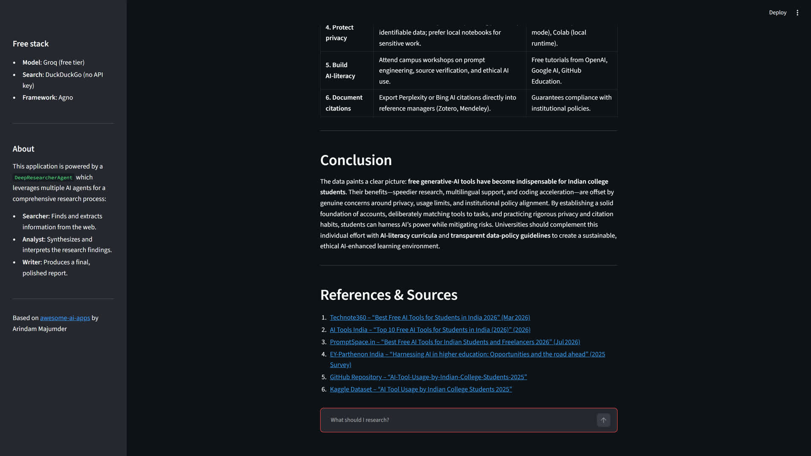

# Deep Researcher Agent (free version)

A multi-stage research agent: ask one question, three AI agents (**Searcher**, **Analyst**, **Writer**) search the web, cross-check what they found, and write a report with headings, tables and a sources list.

This is a free-tools fork of the **Deep Researcher Agent** from [awesome-ai-apps](https://github.com/Arindam200/awesome-ai-apps) by **Arindam Majumder** (MIT licence, kept in [LICENSE](LICENSE)). All credit for the original workflow and UI goes to him.



## What I changed

| | Original | This version |
|---|---|---|
| Model | Nebius (paid key) | **Groq free tier** (`openai/gpt-oss-120b` by default) |
| Web search | Scrapegraph (paid key) | **DuckDuckGo** (no key) + an article reader trimmed to ~3,000 characters per page |
| Agno | latest | pinned to **1.7.5** (the `Workflow` API this code uses was changed in 2.x) |
| Searcher prompt | "be as verbose as possible" | at most **4 tool calls**, then always write an answer |
| Failure handling | an empty stage passed silently to the next | pipeline **stops with a clear error** if the Searcher or Analyst returns nothing |
| UI | Nebius / Scrapegraph key boxes | relabelled, no key boxes (key comes from `.env`) |

Why the Searcher changes: on a free tier the agent read too many full pages, hit token limits and sometimes ended with an empty answer, which made the Writer reply "please send me the summary".

## Run it

You need Python 3.10+ and a free Groq key from <https://console.groq.com/keys>.

```bash
git clone https://github.com/panther-ai-dev/deep-researcher-free
cd deep-researcher-free
python -m venv .venv && source .venv/bin/activate   # Windows: .venv\Scripts\activate
pip install -r requirements.txt
cp .env.example .env                                # then put your key in .env
streamlit run app.py
```

CLI: `python agents.py`. MCP server: see the commented config in `server.py`.
Optional Mistral instead of Groq: `pip install "mistralai<2"` and set `PROVIDER=mistral` + `MISTRAL_API_KEY`.

## Honest notes (measured 2026-10-20)

- Demo question: *"Best free AI tools for college students in India in 2026"*. Full run took **228 seconds** on Groq free + DuckDuckGo.
- Tried first and dropped: OpenRouter free models (timeouts, then the daily free-request cap) and Mistral free (rate limited by the agent's rapid tool calls). Groq free worked.
- DuckDuckGo rate-limits some queries (HTTP 403). The Searcher recovers, but runs can be slower.
- **The report is a draft, not a source.** Models can attach numbers to the wrong source. Open the links and verify any figure before you use it.
- Free tiers have request and token limits, so back-to-back runs may be throttled.

## Demo footage

`record_demo.py` records the running Streamlit app as 4K frames with Playwright and system Chrome (`pip install playwright`).

## Credits

Original app: Arindam Majumder, [awesome-ai-apps](https://github.com/Arindam200/awesome-ai-apps) (MIT). Fork by [panther-ai-dev](https://github.com/panther-ai-dev).
